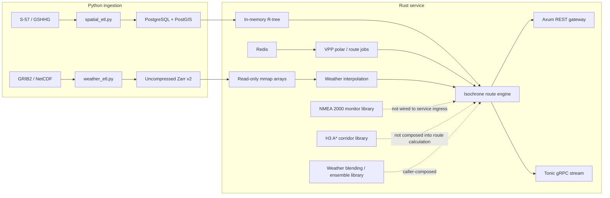

# Sailboat Weather Routing Engine

This directory documents the repository as implemented. The service combines a
Rust routing library and gRPC/REST process with Python weather and coastline
ingestion tools. It is an engineering MVP, not a fully integrated production
navigation product: see the [audit report](./AUDIT_REPORT.md) for verified
coverage, outstanding requirements, and test limitations.

## Architecture

The service loads its configured weather grid and active coastlines/no-go zones
at startup. Route requests obtain the vessel polar from Redis, sample weather,
compose vessel/current velocity, reject obstacle intersections, and retain at
most one candidate for each of 360 target-bearing buckets per propagation step.
The REST and gRPC adapters translate public units to and from the SI-oriented
core.

## Repository map

| Path | Responsibility |
|---|---|
| [`src/types.rs`](../src/types.rs), [`src/error.rs`](../src/error.rs) | Domain coordinates, weather values, unit wrappers, and errors |
| [`src/physics/`](../src/physics/) | Polar parsing/interpolation, wind-relative kinematics, motor-sailing |
| [`src/weather/`](../src/weather/) | Zarr v2 mmap reader, weather interpolation, regional blending |
| [`src/spatial/`](../src/spatial/) | WGS84 geodesy, R-tree obstacle queries, snap-to-water |
| [`src/core/`](../src/core/) | Isochrone routing, edge costs, H3 corridor search, ensemble/departure helpers |
| [`src/api/`](../src/api/) and [`proto/routing.proto`](../proto/routing.proto) | REST, gRPC, Redis-backed API state, standalone NMEA monitor |
| [`ingestion/`](../ingestion/) | GRIB2/NetCDF-to-Zarr and S-57/GSHHG-to-PostGIS CLIs |
| [`migrations/`](../migrations/) | PostGIS schema |
| [`tests/golden_cases/`](../tests/golden_cases/) | Deterministic routing/physics acceptance cases |
| [`benches/routing_bench.rs`](../benches/routing_bench.rs) | Criterion micro- and end-to-end benchmarks |

### Dependency direction

The Rust library is divided into domain types/errors, lower-level physics,
weather and spatial modules, the core router, then the API adapters. Python
ingestion writes data stores consumed by the service; it is not called from
the route calculation. H3 corridors, weather blending, ensemble/departure
optimization, and NMEA monitoring are separately callable library features;
they are not all part of the production request path.

## Documentation index

1. [Audit and requirements traceability](./AUDIT_REPORT.md)
2. [Setup, configuration, and operations](./01_SETUP_AND_OPERATIONS.md)
3. [Core algorithms and math](./02_CORE_ALGORITHMS_AND_MATH.md)
4. [Data formats and storage](./03_DATA_AND_STORAGE.md)
5. [gRPC, REST, and NMEA interfaces](./04_API_REFERENCE.md)
6. [Testing, benchmarks, and SLA evidence](./05_TESTING_AND_BENCHMARKS.md)

## Current scope boundaries

- Wave-resistance reduction is excluded from the MVP (Q-003); no resistance
  model exists in `src/physics/`.
- Dynamic under-keel clearance (UKC), squat, and heel-clearance routing remain
  blocked by Q-004. The migration's bathymetry table is not loaded by the route
  engine.
- `main.rs` starts without a climatology source, so fallback is available to
  library callers that supply one but is not enabled by default in the service.
- The NMEA component emits a reroute event and updated request; it has no live
  NMEA network adapter or automatic invocation of the routing service.
- The repository declares Rust 1.80 as its minimum, but this audit ran on Rust
  1.100. See [verification evidence](./05_TESTING_AND_BENCHMARKS.md).
